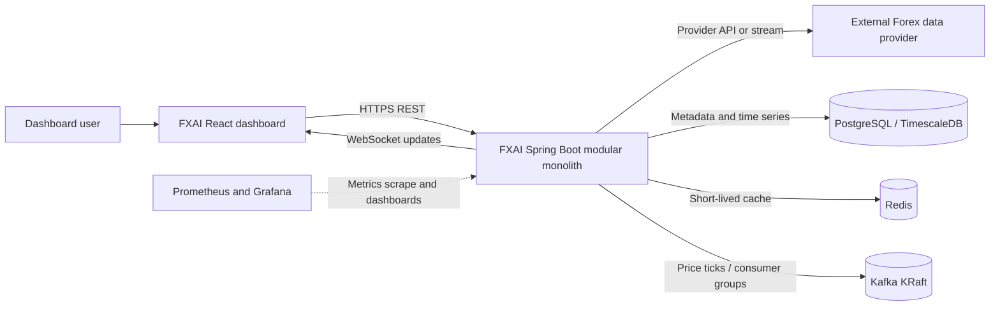
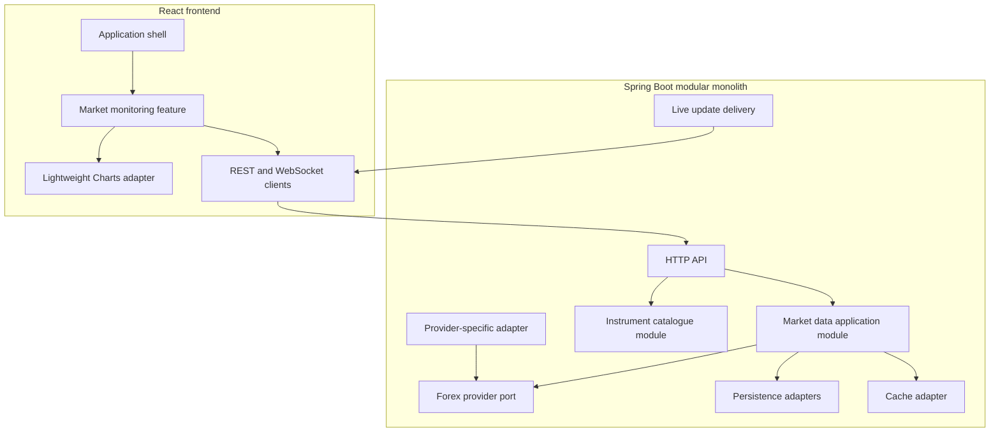
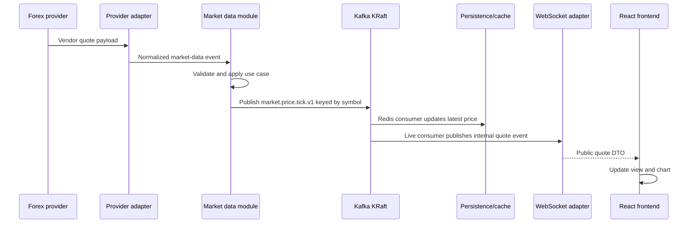
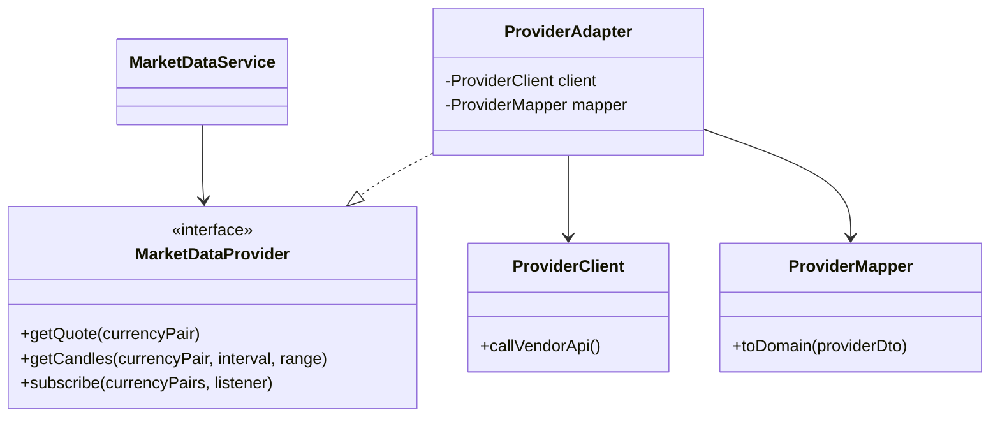
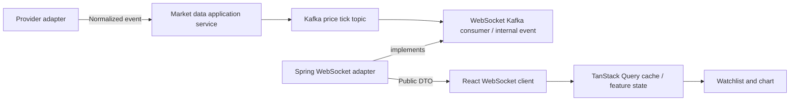
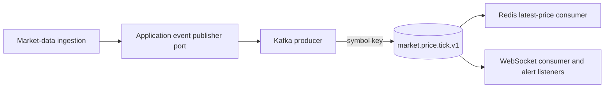

# FXAI V1 Architecture

## Purpose and scope

FXAI V1 is a real-time Forex market monitoring dashboard. It receives market data from a replaceable external provider, presents current and historical prices, and streams live updates to browser clients.

V1 is monitoring-only. It does not include trading, order execution, paper trading, automated strategies, portfolio management, machine-learning predictions, LLM features, retrieval-augmented generation, or AI agents.

The repository is a monorepo whose root represents `fxai/`:

```text
fxai/
├── backend/
├── frontend/
├── infrastructure/
└── docs/
```

## Delivery status

### Implemented

- A Spring Boot 4.1 and Gradle backend using a Java 25 LTS toolchain.
- A versioned `GET /api/v1/health` endpoint, validated local-profile CORS configuration, ECS structured console logging, and automated backend tests.
- A minimal React, TypeScript, and Vite frontend that builds and renders an application shell.
- Repository directories for future infrastructure and architecture documentation.
- PostgreSQL persistence for currency pairs, price alerts, and historical candles, with Flyway-managed schema migrations.
- A TimescaleDB hypertable for historical candle data and Docker Compose configuration for local development.
- Testcontainers-backed repository and migration integration tests.
- Redis latest-price caching, provider polling, and WebSocket price delivery.
- Kafka KRaft distribution of normalized price ticks to independent Redis and live-delivery consumer groups.

### Planned V1 work

- Instrument discovery and selection.
- Current quote and historical price queries.
- A replaceable external Forex market-data provider adapter.
- Prometheus metrics and Grafana dashboards.
- Validation, error handling, resilience, and security appropriate to each exposed boundary.

Items in the planned list are architectural direction, not functionality supplied by the initial scaffold.

## System context

The browser communicates only with the FXAI backend. Provider credentials and provider-specific payloads remain on the server. The backend normalizes external data into provider-neutral domain values before exposing it to the frontend.



Solid lines represent the intended primary runtime interactions. Dashed lines are future V1 integrations that are not part of the initial scaffold.

## Major modules

FXAI starts as a modular monolith. Modules are logical boundaries within one deployable backend rather than separately deployed services.



Dependencies point inward toward application and domain contracts. Provider, database, cache, REST, and WebSocket concerns are adapters at system boundaries.

## Request and data flows

### Initial page and snapshot query

1. The browser loads the React application.
2. TanStack Query will request supported instruments and an initial market snapshot through REST endpoints.
3. The backend validates request parameters and invokes an application use case.
4. The use case reads normalized data from a repository or cache, fetching from the provider through its port when required.
5. The REST adapter maps domain results to API DTOs.
6. The frontend stores server-owned data in the TanStack Query cache and renders it.

### Live market update

1. A provider adapter receives or polls an external quote.
2. It maps the vendor payload to a provider-neutral domain event using UTC timestamps and precise decimal values.
3. `PriceIngestionService` validates the event and waits for Kafka producer acknowledgement.
4. Kafka distributes the symbol-keyed event to independent Redis and WebSocket consumer groups.
5. The Redis consumer atomically updates the latest quote if newer. The WebSocket consumer publishes the existing internal quote event for WebSocket delivery and alert evaluation.
6. The frontend merges the update into query data or feature-local state and updates the chart.



## Backend structure

The backend will use package-by-feature boundaries. Each feature may contain its own domain, application, and adapter packages when those layers become necessary; empty abstractions are not created in advance.

```text
backend/src/main/java/.../fxai/
├── FxaiApplication.java
├── common/                 # Small cross-cutting types and configuration
├── instrument/             # Supported currency-pair catalogue
├── market/                 # Quotes, candles, history, and provider port
└── streaming/              # Future WebSocket delivery and subscriptions
```

Expected responsibilities:

- `instrument`: currency-pair identifiers, supported-instrument queries, and related validation.
- `market`: provider-neutral quote/candle domain types and market-data use cases.
- `streaming`: client subscriptions and mapping domain updates to WebSocket DTOs.
- `common`: genuinely shared configuration and technical utilities only; it must not become a miscellaneous dumping ground.

REST controllers, WebSocket handlers, persistence entities, provider DTOs, and domain models remain distinct. Persistence entities are never returned directly by public APIs.

## Frontend structure

The frontend will group behavior by feature while keeping reusable primitives small:

```text
frontend/src/
├── app/                    # Bootstrap, providers, routing, and layout
├── features/
│   └── market-monitoring/  # Screens, queries, live updates, and view models
├── entities/               # Shared client-side market/instrument models
├── shared/
│   ├── api/                # REST and WebSocket clients
│   ├── lib/                # Focused utilities
│   └── ui/                 # Reusable presentation components
└── test/                   # Shared test setup and helpers
```

TanStack Query owns server state and request caching. Zustand is introduced only if state must be shared across otherwise unrelated components and cannot be represented cleanly by the URL, component state, or TanStack Query. Lightweight Charts is isolated behind feature components so chart-library details do not spread through the application.

## External Forex provider abstraction

The application layer depends on a provider port defined in provider-neutral terms. An adapter implements that port for a selected vendor.



The exact port methods will be shaped by implemented use cases rather than copied blindly from this conceptual diagram. Vendor authentication, symbols, rate limits, retry rules, and payload DTOs stay inside the adapter. Financial values use `BigDecimal` where precision matters. Domain timestamps use UTC; external API timestamps use ISO-8601.

## Persistence strategy

- PostgreSQL is the system of record for relational metadata and durable application data.
- TimescaleDB is considered for quote or candle tables when hypertables, retention policies, compression, or time-bucket queries materially improve the V1 workload.
- Redis is used only for justified short-lived caching, deduplication, or coordination. It is not a durable source of truth.
- Schema changes are versioned with Flyway; Hibernate validates the migrated schema and does not evolve it.
- Persistence entities remain adapter details and are mapped to domain models and API DTOs.
- Database timestamps are stored in UTC. Financial prices use exact numeric columns compatible with Java `BigDecimal`.

Price alerts use a JPA persistence adapter behind the domain repository contract. Provider-fetched historical candles are persisted through a dedicated application service, while REST responses continue to use API DTOs rather than JPA entities. The candle table is a TimescaleDB hypertable partitioned by its UTC candle timestamp.

Redis stores only the latest provider-normalized quote for each supported symbol. The REST latest-price use case checks a key such as `fxai:price:EURUSD`, calls `MarketDataProvider` on a miss, and writes the returned quote with a configurable short TTL. Values use an explicit JSON representation without Java serialization metadata. Cache failures degrade to a provider call (or an ignored cache write), and Redis has no durable volume because it is never authoritative. PostgreSQL/TimescaleDB and the external provider retain their existing responsibilities; candles, alerts, supported pairs, and arbitrary API responses are not added to Redis.

## WebSocket flow

The backend exposes `/ws/market` for server-to-browser `PRICE_UPDATE` messages. A Kafka consumer invokes the existing in-process quote listeners for delivery and alert evaluation. REST cache misses remain synchronous provider reads and do not broadcast ticks.

The intended boundary is:



The public message schema is versionable and independent from provider DTOs and persistence entities. Clients must tolerate reconnects and obtain a fresh REST snapshot before applying subsequent live updates.

## Kafka price tick distribution

Kafka runs in KRaft mode with no ZooKeeper. The backend remains one modular monolith. The scheduled poller delegates to `PriceIngestionService`, which reads the replaceable `MarketDataProvider` and publishes through `PriceTickPublisher`. Only scheduled ingestion publishes ticks; a REST cache miss still returns its provider snapshot directly.

`market.price.tick.v1` has three partitions by default, one replica for local development, and 24-hour delete retention. Spring Kafka Admin creates it at startup; broker automatic topic creation is disabled. Provision it explicitly and set `FXAI_KAFKA_CREATE_TOPICS=false` where application topic creation is disallowed. Partition count and replication factor are configurable; existing replication assignments require an administrative reassignment. The Kafka key is the normalized symbol, preserving per-symbol partition order. Do not change partition count without considering ordering during the transition.

The JSON value contains exactly these contract fields:

| Field | Representation |
|---|---|
| `eventId` | UUID generated once per ingested quote, retained during producer retries |
| `eventType` | `MARKET_PRICE_TICK` |
| `schemaVersion` | integer `1` |
| `symbol` | supported FXAI symbol, e.g. `EURUSD` |
| `bid`, `ask`, `mid`, `spread` | precise JSON decimal numbers mapped to `BigDecimal` |
| `timestamp` | provider observation time, ISO-8601 UTC |
| `source` | selected provider identifier, e.g. `mock` or `oanda` |

Producer keys use `StringSerializer`; values use the Jackson 3 `JacksonJsonSerializer`. Consumer values use `ErrorHandlingDeserializer` wrapping `JacksonJsonDeserializer` with a fixed event target type, disabled type headers, and a restricted trusted package. The event constructor validates schema, supported symbols, required fields, and price consistency. Consumers reject key/symbol mismatches.

Two independent consumer groups receive every tick:

- `fxai-latest-price-v1` updates Redis. A Lua compare-and-set prevents duplicate or older timestamps from replacing a cached quote, including races with REST writes. Equal timestamps keep the first quote. Rejected writes do not refresh TTL. Kafka cache writes propagate Redis errors for retry; REST writes retain their best-effort fallback. The timestamp guard lasts as long as the cache entry; after expiry, replay can temporarily seed an older quote until subsequent ticks arrive.
- `fxai-websocket-local-v1` publishes the existing internal quote event to WebSocket and alert listeners. It keeps a bounded per-supported-symbol timestamp watermark, suppressing duplicate and older events in that process. New groups start at the latest offset; existing groups resume committed offsets. The watermark resets on restart, so replay can repeat notifications. Price messages represent state updates, and clients must tolerate repeats and refresh a REST snapshot after reconnect. Existing alert evaluation only transitions active alerts. Give **each backend instance serving WebSocket sessions a distinct stable** `FXAI_KAFKA_WEBSOCKET_GROUP`, otherwise group balancing would deliver a tick to only one instance. Redis instances share the Redis group.

There is no tick persistence consumer: historical candles retain their existing provider-fetch/JPA/TimescaleDB flow. Tick storage would require a separate schema and retention decision.

Delivery is at least once; there are no Kafka transactions or exactly-once semantics. Producer idempotence is explicitly disabled, with `acks=all`, three retries, one in-flight request, a 5-second metadata/request timeout, and a 15-second delivery deadline. Publication failures are logged by ingestion; the next scheduled poll fetches fresh data. There is no outbox, so a failed publication or process crash can lose an observed tick. Consumer automatic commits are disabled; record offsets are committed after successful handling. Runtime handler failures retry three times at one-second intervals, configurable through `FXAI_KAFKA_RETRY_ATTEMPTS` and `FXAI_KAFKA_RETRY_INTERVAL` (milliseconds). Invalid schema/key and deserialization failures are non-retryable. Exhausted/invalid records are logged and skipped, with topic/partition/offset for operator replay within retention. V1 has no dead-letter topic; skipping is deliberate for a live monitoring stream. WebSocket socket failures retain their existing log-and-disconnect behavior, with REST refresh on reconnect.

Logs use the existing ECS structured console output. Producer successes are DEBUG; ingestion failures and retry attempts are WARN; discarded records are ERROR. Payloads and credentials are not logged. `FXAI_KAFKA_LOG_LEVEL` controls the messaging package.



## Security and configuration

Provider credentials, database passwords, and other secrets are supplied through environment variables or an external secret store and are never committed. Public inputs are validated at the boundary, failures return meaningful non-sensitive errors, and provider failures are translated into application-level outcomes. Spring Security will be introduced only when an explicit V1 security requirement is defined.
