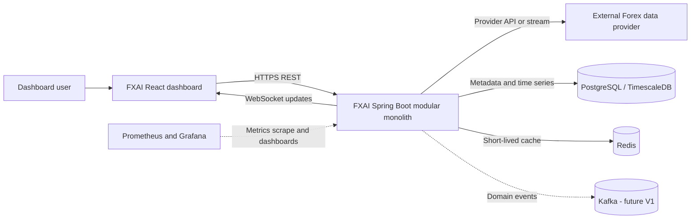
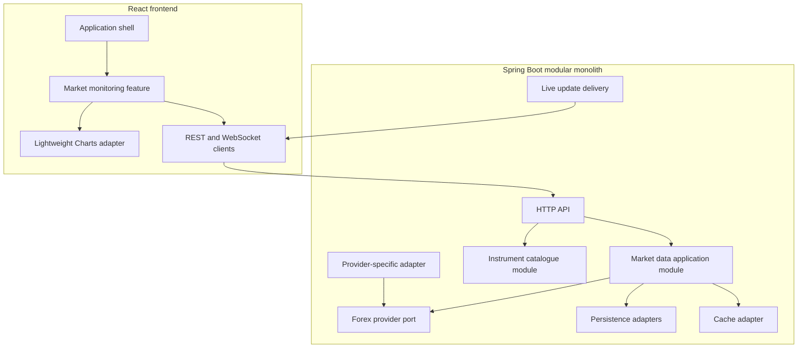
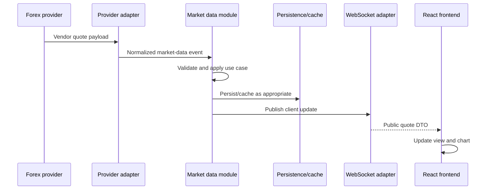
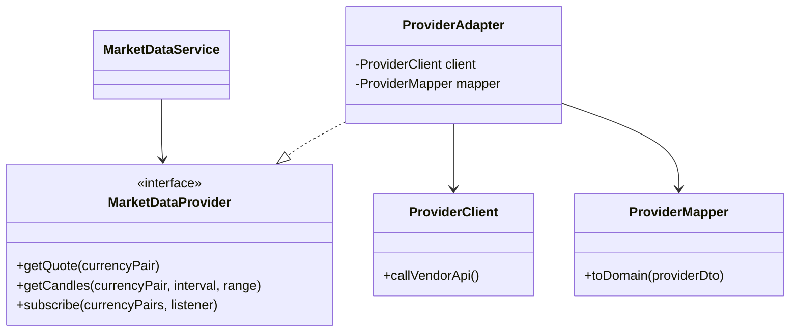
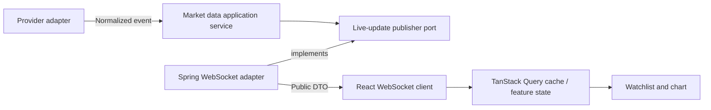
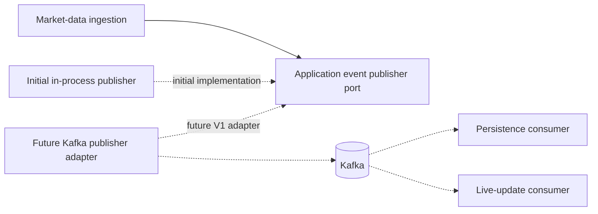

# FXAI V1 Architecture

## Purpose and scope

FXAI V1 is a real-time Forex market monitoring dashboard. It receives market data from a replaceable external provider, presents current and historical prices, and streams live updates to browser clients.

V1 is monitoring-only. It does not include trading, order execution, paper trading, automated strategies, portfolio management, machine-learning predictions, LLM features, retrieval-augmented generation, or AI agents.

The repository is a monorepo whose root represents `fxai/`:

```text
fxai/
├── backend/
├── frontend/
├── infrastructure/
└── docs/
```

## Delivery status

### Implemented

- A Spring Boot 4.1 and Gradle backend using a Java 25 LTS toolchain.
- A versioned `GET /api/v1/health` endpoint, validated local-profile CORS configuration, ECS structured console logging, and automated backend tests.
- A minimal React, TypeScript, and Vite frontend that builds and renders an application shell.
- Repository directories for future infrastructure and architecture documentation.
- PostgreSQL persistence for currency pairs, price alerts, and historical candles, with Flyway-managed schema migrations.
- A TimescaleDB hypertable for historical candle data and Docker Compose configuration for local development.
- Testcontainers-backed repository and migration integration tests.

### Planned V1 work

- Instrument discovery and selection.
- Current quote and historical price queries.
- A replaceable external Forex market-data provider adapter.
- Redis caching for appropriate short-lived market data and coordination needs.
- Server-to-browser live updates through WebSocket.
- Kafka-based internal event distribution when the simpler in-process flow no longer meets V1 reliability or throughput needs.
- Prometheus metrics and Grafana dashboards.
- Validation, error handling, resilience, and security appropriate to each exposed boundary.

Items in the planned list are architectural direction, not functionality supplied by the initial scaffold.

## System context

The browser communicates only with the FXAI backend. Provider credentials and provider-specific payloads remain on the server. The backend normalizes external data into provider-neutral domain values before exposing it to the frontend.



Solid lines represent the intended primary runtime interactions. Dashed lines are future V1 integrations that are not part of the initial scaffold.

## Major modules

FXAI starts as a modular monolith. Modules are logical boundaries within one deployable backend rather than separately deployed services.



Dependencies point inward toward application and domain contracts. Provider, database, cache, REST, and WebSocket concerns are adapters at system boundaries.

## Request and data flows

### Initial page and snapshot query

1. The browser loads the React application.
2. TanStack Query will request supported instruments and an initial market snapshot through REST endpoints.
3. The backend validates request parameters and invokes an application use case.
4. The use case reads normalized data from a repository or cache, fetching from the provider through its port when required.
5. The REST adapter maps domain results to API DTOs.
6. The frontend stores server-owned data in the TanStack Query cache and renders it.

### Live market update

1. A provider adapter receives or polls an external quote.
2. It maps the vendor payload to a provider-neutral domain event using UTC timestamps and precise decimal values.
3. The application layer validates and processes the event.
4. Persistence and caching adapters store the appropriate representation.
5. The live-update adapter maps the event to a public WebSocket DTO and broadcasts it to subscribed clients.
6. The frontend merges the update into query data or feature-local state and updates the chart.



## Backend structure

The backend will use package-by-feature boundaries. Each feature may contain its own domain, application, and adapter packages when those layers become necessary; empty abstractions are not created in advance.

```text
backend/src/main/java/.../fxai/
├── FxaiApplication.java
├── common/                 # Small cross-cutting types and configuration
├── instrument/             # Supported currency-pair catalogue
├── market/                 # Quotes, candles, history, and provider port
└── streaming/              # Future WebSocket delivery and subscriptions
```

Expected responsibilities:

- `instrument`: currency-pair identifiers, supported-instrument queries, and related validation.
- `market`: provider-neutral quote/candle domain types and market-data use cases.
- `streaming`: client subscriptions and mapping domain updates to WebSocket DTOs.
- `common`: genuinely shared configuration and technical utilities only; it must not become a miscellaneous dumping ground.

REST controllers, WebSocket handlers, persistence entities, provider DTOs, and domain models remain distinct. Persistence entities are never returned directly by public APIs.

## Frontend structure

The frontend will group behavior by feature while keeping reusable primitives small:

```text
frontend/src/
├── app/                    # Bootstrap, providers, routing, and layout
├── features/
│   └── market-monitoring/  # Screens, queries, live updates, and view models
├── entities/               # Shared client-side market/instrument models
├── shared/
│   ├── api/                # REST and WebSocket clients
│   ├── lib/                # Focused utilities
│   └── ui/                 # Reusable presentation components
└── test/                   # Shared test setup and helpers
```

TanStack Query owns server state and request caching. Zustand is introduced only if state must be shared across otherwise unrelated components and cannot be represented cleanly by the URL, component state, or TanStack Query. Lightweight Charts is isolated behind feature components so chart-library details do not spread through the application.

## External Forex provider abstraction

The application layer depends on a provider port defined in provider-neutral terms. An adapter implements that port for a selected vendor.



The exact port methods will be shaped by implemented use cases rather than copied blindly from this conceptual diagram. Vendor authentication, symbols, rate limits, retry rules, and payload DTOs stay inside the adapter. Financial values use `BigDecimal` where precision matters. Domain timestamps use UTC; external API timestamps use ISO-8601.

## Persistence strategy

- PostgreSQL is the system of record for relational metadata and durable application data.
- TimescaleDB is considered for quote or candle tables when hypertables, retention policies, compression, or time-bucket queries materially improve the V1 workload.
- Redis is used only for justified short-lived caching, deduplication, or coordination. It is not a durable source of truth.
- Schema changes are versioned with Flyway; Hibernate validates the migrated schema and does not evolve it.
- Persistence entities remain adapter details and are mapped to domain models and API DTOs.
- Database timestamps are stored in UTC. Financial prices use exact numeric columns compatible with Java `BigDecimal`.

Price alerts use a JPA persistence adapter behind the domain repository contract. Provider-fetched historical candles are persisted through a dedicated application service, while REST responses continue to use API DTOs rather than JPA entities. The candle table is a TimescaleDB hypertable partitioned by its UTC candle timestamp. Redis remains unimplemented until a concrete caching or coordination use case requires it.

## WebSocket flow

The backend will expose a WebSocket endpoint for server-to-browser market updates. The connection protocol, destination naming, subscription limits, heartbeat behavior, and reconnect semantics will be specified when the first live-data use case is implemented.

The intended boundary is:



The public message schema is versionable and independent from provider DTOs and persistence entities. Clients must tolerate reconnects and obtain a fresh REST snapshot before applying subsequent live updates.

## Future Kafka integration within V1

Kafka is deferred until a concrete V1 need exists for durable asynchronous distribution, replay, buffering, or independent consumers. The first implementation may publish domain events in-process behind an application-owned event-publisher interface. A Kafka adapter can later implement that interface without changing provider or domain contracts.

Potential V1 topics include normalized market-data updates and ingestion health events. Topic names, partitions, retention, message keys, schemas, delivery semantics, and idempotency rules will be decided from measured requirements. Kafka must not turn the initial modular monolith into premature microservices.



## Security and configuration

Provider credentials, database passwords, and other secrets are supplied through environment variables or an external secret store and are never committed. Public inputs are validated at the boundary, failures return meaningful non-sensitive errors, and provider failures are translated into application-level outcomes. Spring Security will be introduced only when an explicit V1 security requirement is defined.
